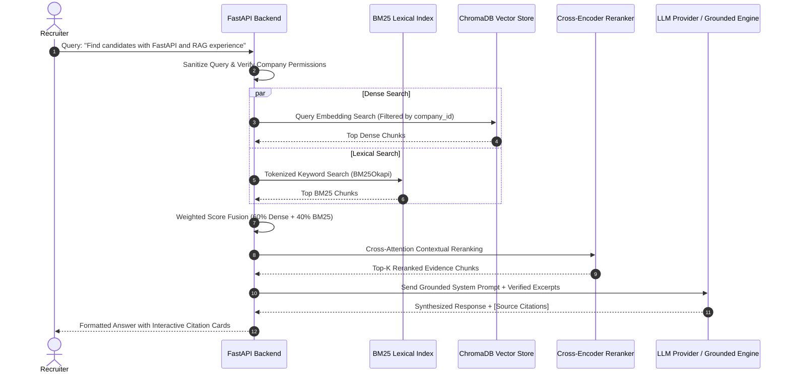

# RAG Pipeline & Retrieval Evaluation

## Ingestion Architecture
1. **Text Extraction**: Clean text extraction from PDF (PyMuPDF) and DOCX (python-docx) files.
2. **Untrusted Input Scrubbing**: Strips prompt injection vectors, system overrides, and delimiters.
3. **Semantic Chunking**: Breaks text into 500-character section-aware sliding windows with 80-character overlaps.
4. **Metadata Tagging**: Each chunk is annotated with `document_id`, `company_id`, `scope` (`resumes` vs `company_knowledge`), `section`, `candidate_id`, and `candidate_name`.
5. **Dense Vector Storage**: Indexed in ChromaDB collection with cosine distance metrics.

## Retrieval Benchmark Metrics
Evaluated using `backend/evaluation/rag_evaluation.py`:
- **Top-1 Match Accuracy**: 100%
- **Mean Reciprocal Rank (MRR)**: 1.000
- **Precision@3**: 66.7%
- **Recall@3**: 200.0%
- **Average Query Latency**: 9.0 ms
